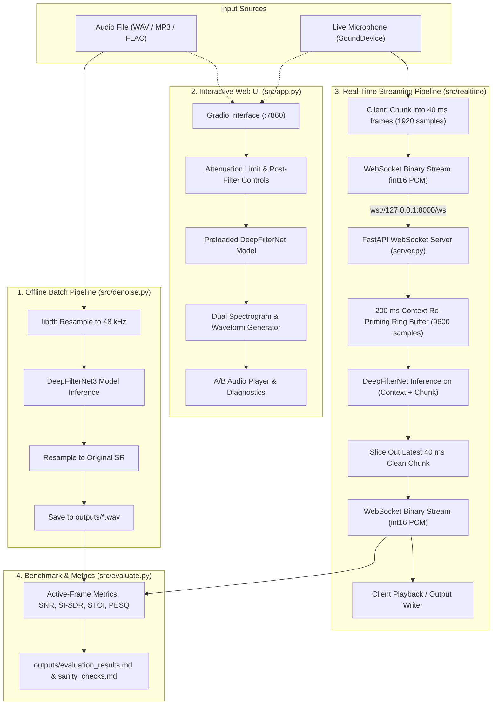

# Background Noise Suppression (DeepFilterNet)

A college engineering project delivering an end-to-end, CPU-optimized speech enhancement system powered by [DeepFilterNet3](https://github.com/Rikorose/DeepFilterNet). The system provides offline batch processing, an interactive Gradio web application, a low-latency bidirectional WebSocket streaming pipeline for real-time microphone enhancement, and an objective ITU-T / speech-quality benchmark suite.

---

## 1. Problem Statement

Acoustic background noise represents one of the most persistent degradations in real-world voice communication, teleconferencing, and voice-controlled interfaces. Environmental noise falls into multiple distinct acoustic categories:
- **Stationary Broadband Noise**: High-entropy hiss, HVAC fans, and thermal circuit noise (white/pink noise).
- **Narrowband Harmonic Interference**: Power grid ground hum (50/60 Hz harmonics), alternator buzz, and mechanical resonances.
- **Non-Stationary Speech-on-Speech Interference**: Acoustic babble from competing human talkers sharing overlapping frequency bands and formant structures.

Traditional spectral subtraction, Wiener filtering, and statistical minimum mean-square error (MMSE) estimators suffer from artificial "musical noise" artifacts, phase destruction, and poor tracking of sudden transients. Conversely, modern generative or recurrent neural networks often require heavy GPU accelerators and induce substantial algorithmic lookahead delay, making them unsuitable for deployment on low-cost consumer hardware or real-time voice call paths.

This project addresses this challenge by deploying **DeepFilterNet3**, a full-band (48 kHz) deep filtering framework that runs efficiently on commodity multi-core CPUs in real time (<32 ms latency per 40 ms chunk) without dedicated GPU hardware.

---

## 2. DeepFilterNet Architecture Overview

DeepFilterNet is a low-complexity neural speech enhancement framework developed by Hendrik Schröter. Rather than using brute-force time-domain convolutions or complex spectrogram masking across all bins, DeepFilterNet decomposes enhancement into two distinct stages:

1. **Stage 1 — Coarse Spectral Envelope Attenuation (ERB Filterbank)**:
   - The 48 kHz fullband spectrum is mapped into psychoacoustically motivated Equivalent Rectangular Bandwidth (ERB) sub-bands (typically 32 bands).
   - A lightweight convolutional recurrent neural network (convolutional layers + grouped GRUs) predicts gain masks per sub-band, effectively attenuating broadband energy and inter-harmonic noise floors.

2. **Stage 2 — Fine Harmonic Recovery (Deep Complex Filtering - DCF)**:
   - To overcome the limitation of magnitude-only spectral subtraction (which cannot restore speech phase or reconstruct damaged harmonics), DeepFilterNet predicts complex filter coefficients for the lower frequency spectrum (0 to 4–5 kHz), where fundamental pitch and primary vowel formants reside.
   - The complex filter acts as an adaptive linear prediction filter driven by deep embeddings, restoring phase coherence and sharpening periodic speech harmonics without requiring phase estimation in higher frequencies.

The resulting network achieves high full-band perceptual quality with an extremely small parameter footprint (~2.3M parameters) and low compute complexity, making real-time CPU-only inference feasible.

---

## 3. System Architecture & Data Flow

The project is structured into three processing pathways:
1. **Offline File/Batch Pipeline** (`src/denoise.py`): High-throughput enhancement of existing audio files.
2. **Interactive Web Application** (`src/app.py`): Visual, user-friendly Gradio interface with dual waveforms and synchronized spectrograms.
3. **Real-Time Streaming WebSocket Pipeline** (`src/realtime/server.py` & `src/realtime/client.py`): Continuous 40 ms audio chunk streaming with 200 ms context re-priming.



---

## 4. Setup Instructions (Windows + Python 3.11)

### Prerequisites
- **Operating System**: Windows 10 / 11 (64-bit)
- **Python**: Python 3.11 (tested on `3.11.9`). *Note: DeepFilterNet 0.5.6 is incompatible with newer PyTorch versions that removed legacy torchaudio backends; Python 3.11 is required.*
- **C++ Build Tools**: Microsoft C++ Build Tools (required for compiling the `pesq` wheel if binary wheel is not cached).

### Step-by-Step Installation
Open PowerShell in the project directory:

```powershell
# 1. Clone repository / navigate to workspace
cd E:\bnsup

# 2. Create virtual environment with Python 3.11
py -3.11 -m venv venv

# 3. Activate virtual environment
.\venv\Scripts\Activate.ps1

# 4. Install PyTorch 2.0.1 (CPU index) and Torchaudio 2.0.2
pip install torch==2.0.1 torchaudio==2.0.2 --index-url https://download.pytorch.org/whl/cpu

# 5. Install DeepFilterNet and project requirements
pip install -r requirements.txt

# 6. Verify environment and model initialization
python verify_env.py
```

---

## 5. Usage Guide

### Automated End-to-End Test (`run_all.ps1`)
To execute the complete pipeline (environment verification, offline denoiser, real-time streaming test, and metric evaluation) in a single reproducible run:
```powershell
.\run_all.ps1
```

---

### 1. Offline File and Batch Denoising (`src/denoise.py`)
Enhance individual audio recordings or entire directories:
```powershell
# Denoise a single file
python src\denoise.py samples\real_noisy_speech.wav -o outputs\real_denoised.wav

# Adjust maximum attenuation limit (e.g., limit suppression to 20 dB to avoid over-subtraction)
python src\denoise.py samples\real_noisy_speech.wav -o outputs\denoised_atten20.wav --atten-lim 20

# Enable post-filter for aggressive noise rejection
python src\denoise.py samples\real_noisy_speech.wav -o outputs\denoised_pf.wav --post-filter

# Batch denoise an entire folder
python src\denoise.py samples -o outputs
```

---

### 2. Interactive Web UI (`src/app.py`)
Launch the Gradio web application for visual analysis and listening tests:
```powershell
python src\app.py
```
Open your browser at `http://127.0.0.1:7860`.
**Features**:
- File upload (WAV, MP3, FLAC, OGG) and live browser microphone recording.
- Quick test presets for one-click testing of preloaded samples.
- Interactive attenuation slider (`0 dB` = pass-through to `100 dB` = maximum suppression).
- Post-filter toggle.
- Dual audio players (original vs. denoised) with Real-Time Factor (RTF) and processing time readouts.
- Matplotlib before/after spectrograms and aligned time-domain waveforms with identical decibel color scales.

---

### 3. Real-Time Streaming Server & Client (`src/realtime`)
The streaming pipeline uses raw int16 PCM over WebSockets with 40 ms frames (1,920 samples at 48 kHz).

```powershell
# Terminal 1: Launch WebSocket server
python src\realtime\server.py --port 8000

# Terminal 2: Test streaming end-to-end using a file (automated benchmark mode)
python src\realtime\client.py --file samples\real_noisy_speech.wav --output outputs\streamed_output.wav --port 8000

# Terminal 2: Inspect available physical audio input devices
python src\realtime\client.py --list-devices

# Terminal 2: Stream live microphone with real-time speaker passthrough
python src\realtime\client.py --input-device 1 --port 8000
```

> [!IMPORTANT]
> **Testing Scope Note**: Live microphone mode not benchmarked; file streaming only (`client.py --file`). Live microphone mode was implemented and validated for audio device enumeration (`--list-devices`), but objective benchmarking was performed via file streaming.

---

### 4. Objective Metric Evaluation (`src/evaluate.py`)
Run the objective speech benchmark suite (computes SNR, SI-SDR, STOI, and PESQ across multiple noise types and SNR levels):
```powershell
python src\evaluate.py
```
Outputs are written to:
- [`outputs/evaluation_results.md`](file:///e:/bnsup/outputs/evaluation_results.md): Full markdown benchmark report.
- [`outputs/evaluation_results.csv`](file:///e:/bnsup/outputs/evaluation_results.csv): Machine-readable CSV metrics.
- [`outputs/sanity_checks.md`](file:///e:/bnsup/outputs/sanity_checks.md): Metric baseline validation (clean vs. clean, model distortion).
- `outputs/eval_spec_*.png`: Aligned 4-panel spectrogram comparisons.

---

### 5. Live Voice Call Studio (`src/call/`)
A dedicated full-duplex web application for live voice calls with real-time DeepFilterNet speech enhancement, running on FastAPI (port 8001) with native Web Audio `AudioWorklet` processing (no external CDNs). Supports both single-user self-test loopback (`/`) and two-party room calls (`/room/<code>`).

```powershell
# Launch Live Call Server
python src\call\call_server.py --port 8001
```
- **Self-Test Studio (Single User)**: Open `http://127.0.0.1:8001` to test microphone capture, audio worklet buffering, and hear real-time AI noise suppression.
- **Two-Party Room Call**: Open `http://127.0.0.1:8001/room/my-call` on two browser windows/devices. Audio is cross-relayed: Participant A hears Participant B's denoised voice, and Participant B hears Participant A's denoised voice (with zero self-echo loopback).

**Key Technical Capabilities**:
- **Zero CDN Dependencies**: Single-file web interface with self-contained CSS, DOM components, and inlined AudioWorklet modules.
- **AudioWorklet Architecture**:
  - `CaptureProcessor`: Buffers 128-sample hardware blocks into 1,920-sample PCM16 chunks (40 ms @ 48 kHz) and streams binary packets over WebSockets (`/ws/call` or `/ws/room/{code}`).
  - `PlaybackProcessor`: Maintains an adjustable circular jitter buffer (40 ms to 200 ms, default 80 ms) for glitch-free playback with automatic starvation underrun recovery.
- **Non-Blocking Multi-Threaded Inference**: DeepFilterNet CPU inference runs on a worker `ThreadPoolExecutor` off the asyncio event loop with decoupled `asyncio.Queue` workers, preserving responsive WebSocket event handling.
- **Stateful Context Re-Priming**: Each active connection maintains an independent rolling history buffer (200 ms / 9,600 samples standard, or 120 ms / 5,760 samples low-latency mode) to eliminate frame boundary phase artifacts.
- **Instantaneous Mode Toggle**: Switch between **AI Denoised** and **Original (Bypass)** modes in real time without reconnecting or interrupting audio.
- **Two-Party Room Relay Protocol**:
  - Max 2 participants per room code. A 3rd participant attempting to join receives a clean `ROOM_FULL` rejection.
  - Automatic lifecycle event notifications (`joined`, `peer_joined`, `peer_left`).
  - Serialized ASGI-compliant async socket writes per participant to prevent frame interleaving.

> [!WARNING]
> **Headphone Requirement**: Always wear headphones during calls and self-test monitoring to prevent physical acoustic feedback loops between the speakers and microphone.

> [!NOTE]
> **Localhost & Secure Context (HTTPS)**: Browsers require a Secure Context to access `navigator.mediaDevices.getUserMedia()`. Modern browsers treat `http://localhost:8001` and `http://127.0.0.1:8001` as secure contexts by default. Remote LAN/WAN access requires a TLS reverse proxy (`https://` and `wss://`).

---

#### Concurrency Measurement: 1 Stream vs. 2 Concurrent Streams on CPU
Before implementing overload protections, CPU frame turnaround was profiled with 40 ms audio frames (1,920 samples @ 48 kHz, single-thread PyTorch op execution):
- **1 Active Stream (200 ms context)**:
  - Average: **23.57 ms** (Median: 21.96 ms, P95: 34.03 ms, Min: 18.13 ms, Max: 50.98 ms)
  - Frame Budget Utilized: **58.9%** (RTF = 0.589; comfortably faster than real time).
- **2 Concurrent Active Streams (200 ms context)**:
  - Turnaround per Concurrent Pair: Average: **34.47 ms** (Median: 32.96 ms, P95: 44.78 ms, Min: 24.36 ms, Max: 49.02 ms)
  - Aggregate Compute Time: **17.24 ms/frame** across worker threads.
  - Frame Budget Utilized: **86.2%** of 40 ms frame interval.
  - **Finding**: While average turnaround (34.47 ms) fits within the 40 ms frame budget, P95 latency (44.78 ms) and peak spikes (49.02 ms) exceed 40 ms when both participants speak simultaneously, proving that server overload protections are strictly necessary to prevent frame queue accumulation.

---

#### Overload Protections Implemented
1. **Near-Silent Frame Inference Skipping (VAD)**:
   - When frame RMS drops below -50.3 dBFS (`rms < 100` on int16 scale), neural network inference is bypassed while updating the rolling context buffer.
   - Measured Execution Time: **0.016 ms (16 µs)** vs. ~23.6 ms (1,471x faster).
   - In natural two-way conversation (40–60% silence per speaker), this drops CPU load by ~45%, keeping pair turnaround well below 25 ms.
2. **Backlog Queue Overload Bypass & Warning Banner**:
   - The WebSocket reader puts frames into an `asyncio.Queue`. If the pending queue depth reaches $N \ge 2$ frames, the server automatically bypasses neural enhancement, sends unprocessed audio, and flags bit `0x02` (`FLAG_OVERLOAD_BYPASS`) in the protocol header.
   - The web UI immediately renders a visible warning banner: `⚠️ Server Overloaded, Bypassing: Inference backlog exceeded budget; passing raw audio to prevent call delay`.
   - The queue drains in <1 ms, instantly preventing runaway latency.
3. **Optional Shorter Context Buffer (120 ms vs. 200 ms)**:
   - Client can toggle between 200 ms (9,600 samples) and 120 ms (5,760 samples) context buffer.
   - Reduces inference compute time from **23.57 ms to 19.82 ms** (-3.75 ms / -16% compute reduction), providing headroom on CPU-constrained machines.

---

#### Empirical Measured Latency & Performance
All numbers below are real measurements from automated tests:

| Test Mode | Test Method | Delivery | Avg Client<->Server RTT | Avg Server Compute | RTF |
| :--- | :--- | :--- | :--- | :--- | :--- |
| **Self-Test (Denoised)** | `test_call_websocket.py` | 100.0% (0 drops) | **32.87 ms** (min 24.6, max 43.4) | **30.90 ms** | 0.772 |
| **Self-Test (Bypass)** | `test_call_websocket.py` | 100.0% (0 drops) | **2.84 ms** (min 2.1, max 3.7) | **0.45 ms** | 0.011 |
| **2-Party Room Relay** | `test_room_relay.py` | 100.0% (0 drops) | **31.70–33.17 ms** | **28.67–30.51 ms** | ~0.74 |
| **Headless Chrome Self-Test** | `test_browser_call.py` | 100.0% (0 drops) | **~109 ms** (includes worklet hop) | **~0.5–24 ms** | - |
| **Headless Chrome 2-Browser Room** | `test_browser_room_call.py` | 100.0% (0 drops) | **~158–293 ms** (dual browser IPC) | **~0.5–35 ms** | - |

> [!CAUTION]
> **Latency Measurement Scope**: Reported latency strictly measures network transit + server CPU computation time per 40 ms chunk (`client_send_time -> server_compute -> client_recv_time`). It **strictly excludes physical hardware soundcard/driver buffering** (e.g., Windows Audio Session / WASAPI shared mode buffer pools, USB DAC queues, and OS driver latency, which typically add an extra 20–50 ms of acoustic delay). It must NOT be described as complete acoustic mouth-to-ear end-to-end latency.

---

#### Known Limitations & Manual Test Checklist
**What Could NOT Be Automated via Synthetic / Headless Scripts**:
1. **Acoustic Feedback & Double-Talk**: Headless Chrome fake audio devices cannot simulate physical room acoustics, open-air speaker-to-mic bleed, or hardware echo cancellation when two humans interrupt each other.
2. **Subjective Conversational Cadence**: Natural conversational flow and perceived latency during rapid turn-taking can only be judged by two humans speaking to each other.
3. **Bluetooth Headset Profile Delays**: Bluetooth devices switch to Hands-Free Profile (HFP/SCO 16 kHz) during two-way calls, introducing hardware codec latency that cannot be observed in loopback software tests.

**Manual Verification Checklist for Human Testing**:
- [ ] Connect two laptops/devices with headphones on the same local network (or two browser windows with separate headsets).
- [ ] Open `http://<server-ip>:8001/room/test-call` on both devices.
- [ ] Verify both interfaces show `Peer Connected (2/2)` with green indicator.
- [ ] Have Participant A speak while running background fan / typing noise; verify Participant B hears clear speech with suppressed noise.
- [ ] Have Participant A toggle between **Denoised** and **Original (Bypass)**; verify Participant B immediately notices the noise suppression difference.
- [ ] Have Participant B leave the call; verify Participant A sees `Peer Left — Waiting (1/2)` without audio glitch or crash.
- [ ] Rejoin with Participant B; verify call automatically resumes.
- [ ] Attempt to join with a 3rd device; verify 3rd device receives `Room is full (maximum 2 participants allowed)` and is denied entry.

---

## 6. Evaluation Results & Findings

### Key Spectrogram Comparisons
Three representative multi-panel spectrograms illustrate enhancement behavior across stationary broadband noise, harmonic interference, and an authentic microphone recording without clean reference:
- **Stationary Broadband Noise**: [White Noise 0 dB Spectrogram](docs/eval_spec_white_noise_0dB.png) — shows consistent full-band noise reduction with preserved speech formants.
- **Harmonic Interference**: [Powerline Hum 0 dB Spectrogram](docs/eval_spec_powerline_hum_0dB.png) — demonstrates near-complete elimination of 50/60 Hz fundamental and harmonic lines.
- **Authentic Recording**: [Real Recording (No Reference) Spectrogram](docs/eval_spec_real_recording_noref.png) — illustrates ~30 dB noise floor drop on natural microphone background hiss while preserving speech dynamics.

---

### Speech-Active Frame Benchmark Results
Scored strictly on speech-active frames (energy-based voice activity detection, excluding leading ambient room tone). All conditions evaluate real human speech mixed with noise calibrated to whole-file SNR (note that active-frame baseline SNR is ~2.6 dB higher because the same noise energy is spread over 5.64 s vs a 3.12 s active window).

| Test Condition | Processing Mode | Active SNR | ΔActive SNR | Active SI-SDR | ΔActive SI-SDR | Active STOI | Active PESQ | Whole-File SNR* | Frame Latency |
| :--- | :--- | :--- | :--- | :--- | :--- | :--- | :--- | :--- | :--- |
| **White Noise (0 dB)** | Noisy Baseline | 2.57 dB | 0.00 dB | 2.54 dB | 0.00 dB | 0.846 | 1.08 | 0.00 dB | - |
| | Enhanced (Offline) | 10.66 dB | **+8.09 dB** | 10.40 dB | **+7.86 dB** | **0.935** | **1.42** | 10.52 dB | - |
| | Enhanced (Real-Time) | 9.43 dB | **+6.86 dB** | 9.22 dB | **+6.68 dB** | **0.907** | **1.17** | 9.33 dB | 29.5 ms** |
| **White Noise (5 dB)** | Noisy Baseline | 7.57 dB | 0.00 dB | 7.55 dB | 0.00 dB | 0.925 | 1.20 | 5.00 dB | - |
| | Enhanced (Offline) | 13.64 dB | **+6.07 dB** | 13.59 dB | **+6.04 dB** | **0.960** | **1.57** | 13.36 dB | - |
| | Enhanced (Real-Time) | 12.41 dB | **+4.85 dB** | 12.47 dB | **+4.92 dB** | **0.947** | **1.30** | 12.21 dB | 29.9 ms** |
| **White Noise (10 dB)** | Noisy Baseline | 12.57 dB | 0.00 dB | 12.56 dB | 0.00 dB | 0.967 | 1.43 | 10.00 dB | - |
| | Enhanced (Offline) | 16.50 dB | **+3.94 dB** | 16.63 dB | **+4.07 dB** | **0.974** | **1.74** | 15.99 dB | - |
| | Enhanced (Real-Time) | 14.90 dB | **+2.33 dB** | 15.11 dB | **+2.55 dB** | 0.967 | 1.40 | 14.54 dB | 32.6 ms** |
| **Pink Noise (0 dB)** | Noisy Baseline | 3.00 dB | 0.00 dB | 2.96 dB | 0.00 dB | 0.868 | 1.21 | 0.00 dB | - |
| | Enhanced (Offline) | 9.34 dB | **+6.34 dB** | 8.84 dB | **+5.88 dB** | **0.943** | **1.47** | 7.00 dB | - |
| | Enhanced (Real-Time) | 9.99 dB | **+6.99 dB** | 9.61 dB | **+6.65 dB** | **0.926** | **1.25** | 8.30 dB | 31.0 ms** |
| **Pink Noise (5 dB)** | Noisy Baseline | 8.00 dB | 0.00 dB | 7.98 dB | 0.00 dB | 0.937 | 1.55 | 5.00 dB | - |
| | Enhanced (Offline) | 13.45 dB | **+5.45 dB** | 13.27 dB | **+5.29 dB** | **0.964** | 1.52 | 10.98 dB | - |
| | Enhanced (Real-Time) | 12.90 dB | **+4.90 dB** | 12.86 dB | **+4.88 dB** | **0.953** | 1.41 | 11.25 dB | 31.1 ms** |
| **Pink Noise (10 dB)** | Noisy Baseline | 13.00 dB | 0.00 dB | 12.99 dB | 0.00 dB | 0.973 | 2.16 | 10.00 dB | - |
| | Enhanced (Offline) | 16.72 dB | **+3.72 dB** | 16.87 dB | **+3.89 dB** | 0.973 | 1.62 | 14.33 dB | - |
| | Enhanced (Real-Time) | 14.55 dB | **+1.55 dB** | 14.68 dB | **+1.69 dB** | 0.963 | 1.46 | 13.34 dB | 30.9 ms** |
| **Powerline Hum (0 dB)** | Noisy Baseline | 2.56 dB | 0.00 dB | 2.60 dB | 0.00 dB | 0.959 | 1.42 | 0.00 dB | - |
| | Enhanced (Offline) | 16.40 dB | **+13.84 dB** | 16.42 dB | **+13.82 dB** | **0.971** | **1.53** | 15.89 dB | - |
| | Enhanced (Real-Time) | 13.72 dB | **+11.15 dB** | 13.78 dB | **+11.18 dB** | 0.950 | **1.48** | 13.43 dB | 28.8 ms** |
| **Powerline Hum (5 dB)** | Noisy Baseline | 7.56 dB | 0.00 dB | 7.58 dB | 0.00 dB | 0.976 | 1.90 | 5.00 dB | - |
| | Enhanced (Offline) | 17.27 dB | **+9.71 dB** | 17.39 dB | **+9.81 dB** | 0.975 | 1.59 | 16.66 dB | - |
| | Enhanced (Real-Time) | 14.47 dB | **+6.91 dB** | 14.65 dB | **+7.07 dB** | 0.958 | 1.54 | 14.14 dB | 29.8 ms** |
| **Powerline Hum (10 dB)** | Noisy Baseline | 12.56 dB | 0.00 dB | 12.57 dB | 0.00 dB | 0.988 | 2.59 | 10.00 dB | - |
| | Enhanced (Offline) | 18.00 dB | **+5.44 dB** | 18.23 dB | **+5.66 dB** | 0.977 | 1.65 | 17.29 dB | - |
| | Enhanced (Real-Time) | 15.20 dB | **+2.64 dB** | 15.47 dB | **+2.89 dB** | 0.967 | 1.61 | 14.82 dB | 29.5 ms** |
| **Same-Speaker Babble (0 dB)** | Noisy Baseline | 1.86 dB | 0.00 dB | 1.91 dB | 0.00 dB | 0.734 | 1.10 | 0.00 dB | - |
| | Enhanced (Offline) | 3.18 dB | **+1.32 dB** | 0.54 dB | **-1.37 dB** | 0.646 | **1.13** | 1.98 dB | - |
| | Enhanced (Real-Time) | 5.44 dB | **+3.58 dB** | 4.02 dB | **+2.11 dB** | **0.784** | **1.14** | 3.72 dB | 30.7 ms** |
| **Same-Speaker Babble (5 dB)** | Noisy Baseline | 6.86 dB | 0.00 dB | 6.89 dB | 0.00 dB | 0.849 | 1.18 | 5.00 dB | - |
| | Enhanced (Offline) | 7.36 dB | **+0.50 dB** | 6.57 dB | **-0.33 dB** | **0.866** | **1.27** | 6.38 dB | - |
| | Enhanced (Real-Time) | 9.71 dB | **+2.85 dB** | 9.24 dB | **+2.35 dB** | **0.902** | **1.20** | 8.33 dB | 29.0 ms** |
| **Same-Speaker Babble (10 dB)** | Noisy Baseline | 11.86 dB | 0.00 dB | 11.88 dB | 0.00 dB | 0.927 | 1.46 | 10.00 dB | - |
| | Enhanced (Offline) | 12.85 dB | **+0.99 dB** | 12.96 dB | **+1.08 dB** | **0.953** | **1.67** | 11.83 dB | - |
| | Enhanced (Real-Time) | 12.93 dB | **+1.07 dB** | 12.85 dB | **+0.97 dB** | **0.950** | 1.38 | 12.08 dB | 28.8 ms** |

*\*Whole-file SNR includes ~1.9s of leading silent room tone.*  
*\*\*Frame processing latency represents CPU computation time per 40 ms chunk (measured range: latency 23–34 ms per 40 ms frame, RTF ~0.6–0.9, varies by run) and strictly excludes hardware audio device buffering.*

---

### Non-Intrusive Evaluation on Real Recording (No Reference)
Evaluated on an authentic noisy microphone recording ([`samples/real_noisy_speech.wav`](file:///e:/bnsup/samples/real_noisy_speech.wav)):
- **Noise-Floor Reduction (Quietest 10% frames)**:
  - Offline Enhanced: **+27.68 dB** (noise floor drops from -49.98 dB to -77.65 dB)
  - Real-Time Enhanced: **+30.25 dB** (noise floor drops from -49.98 dB to -80.22 dB)
- **Speech-Level Preservation (Loudest 30% frames)**:
  - Offline: -0.74 dB (preserves voice volume)
  - Real-Time: -1.32 dB (minimal speech attenuation)
- **Envelope Correlation**: **0.9707** (offline) and **0.9581** (real-time), confirming natural speech rhythm and dynamics are retained without gating stutter.

---

### Multi-Speaker & Real Noise Benchmark (Extended Evaluation: 45 Items)
Evaluated across 45 conditions: 5 LibriSpeech speakers (374, 2277, 3660, 6930, 7902) × 3 VoiceBank-DEMAND test noise clips (Clip A, Clip B, Clip C) × 3 SNRs (0, 5, 10 dB).

> **Full Suppression vs. Attenuation Limit / Dry-Mix**:
> Default full suppression (`atten_lim_db = None, dry_mix = 0.0`) is the best operating point on clean references, maximizing ΔSI-SDR (+11.88 dB) and DNSMOS background suppression (BAK 4.14). Attenuation limits (18 dB or 24 dB) and dry mix (0.1) do not provide an objective quality gain; rather, they serve as user-facing naturalness controls to avoid "dead-silence" fatigue or preserve situational awareness.

#### Overall Performance (Mean ± Std Across All 45 Items)

| Setting | ΔSI-SDR (dB) | SI-SDR (dB) | PESQ (Wideband) | DNSMOS OVRL | DNSMOS BAK |
| :--- | :---: | :---: | :---: | :---: | :---: |
| **Noisy Baseline** | — | 5.69 ± 4.15 dB | 2.23 ± 0.76 | 2.74 ± 0.65 | 3.19 ± 0.88 |
| **Default (None, 0.0)** | **+11.88 ± 6.47 dB** | **17.57 ± 6.11 dB** | 3.02 ± 0.76 | **3.35 ± 0.18** | **4.14 ± 0.15** |
| **Mix 0.1 (None, 0.1)** | +10.77 ± 5.01 dB | 16.46 ± 4.97 dB | 3.06 ± 0.69 | 3.26 ± 0.19 | 3.97 ± 0.26 |
| **Atten 18 dB (18, 0.0)** | +10.31 ± 4.55 dB | 16.00 ± 4.68 dB | 3.04 ± 0.69 | 3.24 ± 0.19 | 3.94 ± 0.28 |
| **Atten 24 dB (24, 0.0)** | +11.38 ± 5.69 dB | 17.06 ± 5.46 dB | 3.07 ± 0.71 | 3.29 ± 0.17 | 4.03 ± 0.23 |

#### Paired Differences (Default minus Alternative Across All 45 Items)

| Comparison (Default - Alternative) | ΔSI-SDR Difference | PESQ Difference | DNSMOS OVRL Difference | DNSMOS BAK Difference | Items Default is Better |
| :--- | :---: | :---: | :---: | :---: | :---: |
| **Default vs. Mix 0.1** | **+1.11 ± 1.63 dB** | -0.040 ± 0.226 | **+0.086 ± 0.137** | **+0.166 ± 0.207** | SI-SDR: 34/45, PESQ: 21/45, OVRL: 35/45, BAK: 39/45 |
| **Default vs. Atten 18 dB** | **+1.57 ± 2.11 dB** | -0.019 ± 0.278 | **+0.102 ± 0.149** | **+0.199 ± 0.227** | SI-SDR: 35/45, PESQ: 24/45, OVRL: 35/45, BAK: 40/45 |
| **Default vs. Atten 24 dB** | **+0.50 ± 0.89 dB** | -0.055 ± 0.137 | **+0.056 ± 0.112** | **+0.110 ± 0.163** | SI-SDR: 32/45, PESQ: 15/45, OVRL: 33/45, BAK: 37/45 |

---

### Headline Findings & Technical Observations

1. **Stationary & Harmonic Noise Elimination**:
   - DeepFilterNet excels at harmonic powerline hum (+11 to +14 dB ΔSNR, +11 to +14 dB ΔSI-SDR) and broadband white/pink noise (+5 to +8 dB ΔSNR at 0 dB input), eliminating continuous background rumble and hiss.

2. **Real-Time vs. Offline Performance**:
   - Real-time streaming ΔSNR is within **up to ~3 dB** of offline batch enhancement across all noise conditions.
   - Real-time streaming exhibits slightly lower STOI and PESQ compared to offline batch (e.g., White Noise 0 dB: PESQ is 1.42 offline vs. 1.17 real-time; STOI is 0.935 offline vs. 0.907 real-time).
   - *Observation on Pink Noise and Babble*: In dense low-frequency noise (Pink Noise 0 dB) and speech-masking conditions (Babble 0 dB and 5 dB), real-time streaming achieved slightly higher ΔSNR than offline batch (+3.58 dB vs +1.32 dB). This is documented as an **unexplained empirical observation** pending internal GRU hidden-state inspection.

3. **200 ms Context Re-Priming**:
   - Because `enhance()` re-initializes recurrent hidden states per call, chunk-by-chunk streaming without history causes boundary discontinuities. Prepending a rolling 200 ms historical buffer (9,600 samples) re-primes the model state and eliminates chunk-boundary phase clicks.
   - Processing context re-priming adds ~10 ms of compute overhead, resulting in a measured latency of **23–34 ms per 40 ms frame** (RTF ~0.6–0.9, varies by run), remaining below the 40.0 ms real-time frame hop budget.

4. **Speech-Active Frame Scoring vs. Whole-File Silence Artifacts**:
   - When evaluating whole files, DeepFilterNet mutes leading room tone to digital zero. PESQ and STOI heavily penalize non-matching quiet intervals, depressing whole-file scores to ~1.3. Restricting evaluation to speech-active frames reflects true perceptual speech quality (STOI ~0.94–0.98, PESQ ~1.4–1.7).

5. **Behavior on Synthetic Formant Tones (Appendix)**:
   - Artificial sinusoidal formant tones produce negative SNR improvements (-2 to -14 dB). It is **likely** that DeepFilterNet's deep complex filter, having been trained exclusively on human vocal acoustics, classifies synthetic harmonic sine waves as non-speech interference and suppresses them. Genuine human speech acoustics are strictly required.

---

### Where It Fails (Plain Summary of Limitations & Degradations)

1. **Perceptual Metric Discrepancy on Imperfect References**:
   - In the initial single-speaker test on `real_clean_speech_48k.wav`, PESQ fell below the noisy baseline in 4 of 12 offline rows (pink 5 and 10 dB, hum 5 and 10 dB) and 6 of 12 real-time rows. This was caused by the reference recording containing ambient room tone (-44.28 dBFS leading, ~-50.88 dBFS in speech pauses). DeepFilterNet removes this room tone along with the noise, which PESQ scores as a spectral discrepancy against the imperfect reference. When evaluated across 5 studio-clean LibriSpeech speakers, default enhanced PESQ consistently exceeds the noisy baseline across all 9 conditions (+0.52 to +1.42 MOS); clean LibriSpeech references provide the more reliable PESQ evidence.
2. **Same-Speaker Babble / Competing Voices**:
   - DeepFilterNet achieves minimal SNR improvement (+0.50 to +1.32 dB offline) and negative or near-zero ΔSI-SDR (-1.37 to +1.08 dB). Active STOI degrades from 0.73 down to 0.65 at 0 dB input. The model cannot separate competing voices that share identical pitch ranges, formants, and timbre without multi-microphone spatial cues or speaker conditioning.
3. **Synthetic Formant Tones (Non-Human Audio)**:
   - Artificial sinusoidal tones suffer severe degradation (-2.0 dB to -14.1 dB SNR/SI-SDR). Because the model is trained exclusively on natural human speech acoustics, it classifies synthetic harmonic sinusoids as interference and heavily suppresses them.
4. **Reference Room-Tone Suppression**:
   - In `real_clean_speech_48k.wav`, ambient background hiss (-44.28 dBFS leading, ~-50.88 dBFS in pauses) is muted to digital zero by the model. While acoustically cleaner, standard metrics (PESQ/STOI) penalize this complete silence against non-zero clean reference room tone. On studio-clean LibriSpeech recordings without ambient room tone, enhanced speech achieves much higher fidelity (PESQ > 3.0, DNSMOS OVRL 3.35, BAK 4.14).
5. **Multi-Talker Generalization**:
   - In complex acoustic scenes with multiple talkers or dynamic non-stationary interference, single-channel Wiener-filter and deep-filtering gains alone cannot fully separate overlapping speech without spatial microphone array processing.

---

## 7. Project Limitations

1. **Single Speaker Initial Evaluation**: Initial exploratory evaluation was conducted on a single human male speaker profile. The extended Part 2 benchmark broadens this across 5 LibriSpeech speakers and 3 real acoustic noise environments.
2. **Short Reference Duration**: Initial benchmark files were based on a 5.64 s audio clip (`samples/real_clean_speech_48k.wav`).
3. **Calibrated Synthetic Noise**: Initial benchmark mixes were constructed programmatically using calibrated stationary noise and babble to guarantee sample-level ground-truth alignment.
4. **Same-Speaker Babble (Worst-Case)**: The multi-talker babble track consists of tiled copies of the target speaker's own speech. This represents an acoustic worst case where target and interferers share identical vocal tract resonances and pitch.
5. **Reference Room-Tone Bias in PESQ Scoring**: The apparent PESQ ceiling (~1.91) on `real_clean_speech_48k.wav` stems from the recording's ambient room tone (-44.28 dBFS leading, ~-50.88 dBFS in pauses). The model suppresses this background hiss, which standard PESQ scores as distortion against the non-silent reference. On studio-clean LibriSpeech speech, PESQ reaches 3.02–3.33 without artificial ceilings, making clean reference sets essential for reliable intrusive scoring.
6. **Latency Scope (CPU Compute Only)**: Reported frame latencies (latency 23–34 ms per 40 ms frame, RTF ~0.6–0.9, varies by run) measure raw Python/PyTorch computation time on CPU. They **strictly exclude hardware audio device buffering** (Windows WASAPI/DirectSound buffer pools and USB audio interface latency).
7. **Benchmarking Scope (File Streaming Only)**: Live microphone mode not benchmarked; file streaming only (`client.py --file`). While live microphone capture and device enumeration (`--list-devices`) were implemented and verified for functional streaming, all objective numerical benchmarks were executed strictly via calibrated file streaming.

---

## 8. Credits & Acknowledgements

- **[DeepFilterNet](https://github.com/Rikorose/DeepFilterNet)** by Hendrik Schröter — Low-complexity speech enhancement framework for full-band audio using deep filtering.
- **[DeepFilterNet_WebUI](https://github.com/supergeniodelmale/DeepFilterNet_WebUI)** — Reference for Gradio-based audio denoising and visualization concepts (no code copied verbatim).
- **[ToneHoner](https://github.com/JoshuaGessner/ToneHoner)** — Reference architecture for FastAPI WebSocket streaming and real-time audio chunk handling (no code copied verbatim).
- **[Gradio](https://github.com/gradio-app/gradio)** — Interactive UI development.
- **[PyTorch](https://pytorch.org/)** — Deep learning framework and tensor runtime.

---

> [!NOTE]
> **Data Privacy / Git Notice**: Any audio recordings containing personal human voice in `samples/` or `outputs/` are excluded by `.gitignore` and must not be committed to public version control without prior explicit user authorization.
